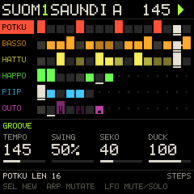

# suom1saundi

Firmware für den **M-VAVE FM-1**: eine Groovebox für **Suomisaundi**, finnischen Freestyle-Psytrance. Psy-Kick,
galoppierender Filterbass, Acid-Linie, 8-Bit-Melodie wie ein alter Soundchip und FM-Zaps, auf einem polymetrischen
Sequencer mit Slides, Chance und **SEKO** – dem Regler, der den Groove jedes Mal ein bisschen anders spielen lässt.



- **Im Browser spielen:** [Emulator](https://g0rst.github.io/suom1saundi/emulator.html) (oder `docs/emulator.html`
  direkt öffnen). Derselbe C-Kern wie in der Firmware, als WebAssembly.
- **Handbuch:** [Deutsch](https://g0rst.github.io/suom1saundi/handbuch.html) ·
  [English](https://g0rst.github.io/suom1saundi/manual.html) ·
  [tlhIngan Hol](https://g0rst.github.io/suom1saundi/tlhingan.html)
  (Quellen: [docs/HANDBUCH.md](docs/HANDBUCH.md), [docs/MANUAL.md](docs/MANUAL.md), [docs/TLHINGAN.md](docs/TLHINGAN.md)).
  Die Tabellen darin schreibt `tools/manual.py` bei jedem Push aus dem Code neu.

## Stand

| Teil | Zustand |
| --- | --- |
| Kern (`app/core/suomi.c`): Klang, Sequencer, Generator, Display | läuft, Host-Tests grün (`tests/run_tests.sh`) |
| Browser-Emulator (`docs/emulator.html`) | läuft (WebAssembly aus demselben Kern) |
| FM-1-Anbindung (`app/app.c`) im Host-Simulator von fm1-base | läuft, Testskript `app/tests/basic.txt` grün (inkl. Speichern und Neustart) |
| Firmware-Paket `.fwsc` | **noch nicht gebaut** (braucht JieLis Toolchain und das AC79-SDK) |
| Lauf auf einem echten FM-1 | **noch nicht getestet** |

**Vor dem Flashen:** Custom-Firmware kann einen FM-1 unbrauchbar machen. Vorher auf die offizielle V15 gehen, Daten
sichern und wissen, wie man zurückkommt (Installer von fm1-base, `base/README.md`).

## Stimmen

| Spur | Synthese | EDIT (K1–K4) | EDIT² (K1–K4) |
| --- | --- | --- | --- |
| **POTKU** | Sinus mit tiefem Pitch-Sweep, Klick, Soft-Clipper | TUNE, DECAY, SWEEP, DRIVE | SNAP, CLICK, HOLD |
| **BASSO** | Säge/Rechteck + Sub, 18-dB-Resonanzfilter mit Hüllkurve, Slides | CUTOFF, RESO, ENVMOD, DECAY | WAVE, SUB, GLIDE, DRIVE |
| **HATTU** | FM-Metall gegen Rauschen, 8-Bit-Rauschkanal (LFSR) | DECAY, TONE, METAL, OPEN | CHIP, SHAKE |
| **HAPPO** | Acid-Linie im 303-Stil: Akzent, Slide | CUTOFF, RESO, ENVMOD, DECAY | WAVE, ACCENT, GLIDE, DRIVE |
| **PIIP** | Soundchip: Puls 12/25/50 %, 4-Bit-Dreieck, Säge, Rauschen; Arpeggio, Vibrato | WAVE, DECAY, ARP, VIBRATO | SPEED, PWM, BEND, DETUNE |
| **OUTO** | FM-Paar mit Feedback und Zap-Hüllkurve: Laser, Blubbern | DECAY, FM, RATIO, ZAP | ZTIME, FEEDBK, WOBBLE, RANDOM |

Pro Spur dazu ein **8-Bit-Crusher** (BITS, RATE), Pegel, Pan, Delay, Hall und Sidechain-Anteil. Summe: Tempo-Delay,
Hall, Kick-Ducking, Drive. 44,1 kHz, Blöcke zu 256 Frames.

## Bedienung (Kurzfassung)

| Bedienelement | Funktion |
| --- | --- |
| PLAY | Start und Stopp |
| 16 weiße Tasten | Steps der Spur; halten + K1/K2/K3/K4: Note, Chance, Akzent/Slide, Ratchet |
| schwarze Tasten 1–6 | Spur: POTKU, BASSO, HATTU, HAPPO, PIIP, OUTO |
| schwarze Tasten 7–11 | CLR, ◀, ▶, NEW (ganzer Groove neu), UNDO |
| HOME | Tempo, Swing, **SEKO**, Duck |
| EDIT, EDIT² | die acht Klangregler der Spur (Step halten: Parameter-Lock) |
| ENV, ENV² | Mix der Spur; 8-Bit (BITS, RATE) |
| FX, FX² | Delay und Hall; Sidechain |
| GLO, GLO² | Grundton, Skala, MIDI-Clock, Chain; XPOSE, DRIVE |
| SEQ, ×2, ×3 | Euklid, Link, Timing |
| ALGORITHM / PRESETS | Looplänge / Pattern A–D |
| SEL / ARP / LFO | Spur neu / leicht verändern / stumm (halten: Solo) |
| REC | Tasten spielen die Spur |
| SAVE | speichern; halten + PRESETS/SELECT: Pattern/Spur kopieren |

Alles Weitere im [Handbuch](docs/HANDBUCH.md).

## Bauen

```
git clone --recursive https://github.com/g0rst/suom1saundi
sh tests/run_tests.sh        # Host-Tests des Kerns (schreibt groove.wav und Screenshots nach build/tests)
./build.sh --host            # Simulator von fm1-base; danach tests/run_tests.sh nochmal
sh sim/build.sh              # Browser-Emulator: docs/emulator.html
./build.sh                   # .fwsc-Paket (braucht JieLis Toolchain und AC79-SDK: base/README.md)
python3 tools/manual.py      # Handbücher aus dem Code; --check prüft nur
```

GitHub Pages einmalig einschalten: **Settings → Pages → Source: GitHub Actions**. Danach veröffentlicht jeder Push auf
`main` Emulator und Handbücher.

## Herkunft und Lizenz

MIT, siehe [LICENSE](LICENSE). Sequencer, Bedienung und Display stammen aus
[ro:MINImal](https://github.com/g0rst/ro-MINImal), 8-Bit-Ideen aus [memetek-fm1](https://github.com/g0rst/memetek-fm1),
Acid- und Filter-Ideen aus [neur0psy](https://github.com/g0rst/neur0psy). Plattform:
[fm1-base](https://github.com/charlesvestal/fm1-base) auf felucca-bsp (MPL-2.0). Nicht mit M-VAVE verbunden.
